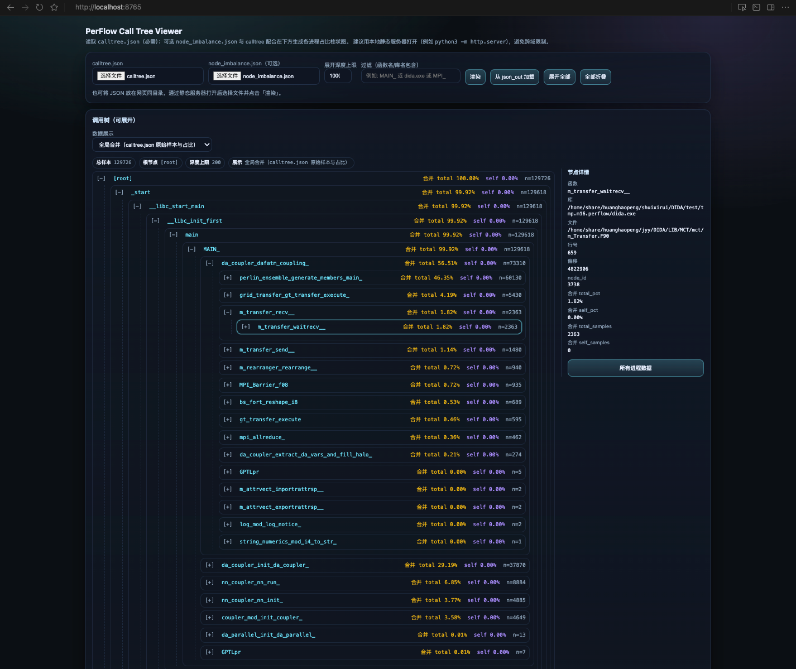
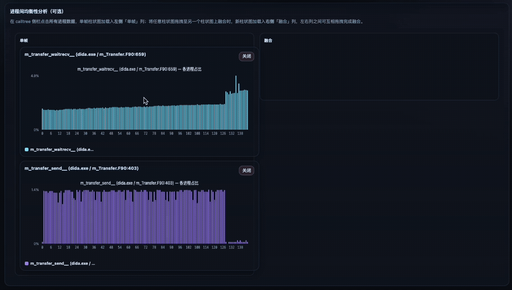

# PerFlow v2.0

[](LICENSE)
[](https://en.cppreference.com/w/cpp/17)

A high-performance, low-overhead profiling tool for parallel MPI applications with comprehensive online analysis capabilities.

## Overview

PerFlow is designed for production-grade performance analysis of HPC applications. It provides ultra-low overhead sampling (<0.5% @ 1kHz), flexible symbol resolution, and powerful analysis tools for understanding application behavior and identifying performance bottlenecks.

**Key Highlights:**
- 🚀 **Ultra-low overhead**: <0.5% with hardware PMU sampling
- 🔧 **Two sampling modes**: Hardware PMU (PAPI) and timer-based (POSIX)
- 📊 **Online analysis**: Real-time performance tree generation
- ⚖️ **Balance analysis**: Workload distribution across processes
- 🔥 **Hotspot detection**: Identify performance bottlenecks
- 📈 **Visualization**: Generate PDF performance trees

## Features

### Sampling-Based Profiling Tool
- **Two sampling modes**: Hardware PMU (PAPI) and Timer-based (POSIX)
- **Hardware PMU mode**: Ultra-low overhead (<0.5% @ 1kHz), cycle-accurate sampling
- **Timer-based mode**: Platform-independent, works in containers/VMs, no special privileges
- Configurable sampling frequencies (100Hz - 10kHz)
- Call stack capture with libunwind
- Per-process sample data collection
- Compressed data (TBD)

### Python Dataflow-based Analysis Framework
- **Dataflow Programming**: Compose workflows as directed acyclic graphs (DAGs)
- **Pre-built Dataflow Nodes**: LoadData, HotspotAnalysis, BalanceAnalysis, Filter, and more
- **Extensible**: Create custom analysis nodes with low-level Python functions
- **Automatic Optimization (TBD)**: Parallel execution, result caching, lazy evaluation
- **Online Analysis Module (TBD)**: Report the performance issues during runtime 

## Documentation

📚 **[Complete Documentation](docs/README.md)** - Full documentation index

### Quick Links
- 🚀 **[Getting Started](docs/user-guide/GETTING_STARTED.md)** - Installation and quick start guide
- ⚙️ **[Configuration](docs/user-guide/CONFIGURATION.md)** - Environment variables and options
- 🔧 **[Troubleshooting](docs/user-guide/TROUBLESHOOTING.md)** - Common issues and solutions
- ❓ **[FAQ](docs/FAQ.md)** - Frequently asked questions
- 🏗️ **[Architecture](docs/developer-guide/ARCHITECTURE.md)** - System design and components
- 🔄 **[Dataflow API Reference](docs/api-reference/dataflow-api.md)** - Python dataflow framework
- 🐍 **[Low-level API Reference](docs/api-reference/python-api.md)** - Python bindings documentation
- 📖 **[C++ API Reference](docs/api-reference/ONLINE_ANALYSIS_API.md)** - Complete C++ API documentation
- 🧪 **[Testing Guide](TESTING.md)** - Comprehensive testing documentation

## Quick Start

### 1. Install Dependencies

```bash
# Ubuntu/Debian
sudo apt-get install -y build-essential cmake libopenmpi-dev libunwind-dev libpapi-dev zlib1g-dev graphviz

# RHEL/CentOS/Fedora
sudo dnf install -y gcc-c++ cmake openmpi-devel libunwind-devel papi-devel zlib-devel graphviz
```

### 2. Build PerFlow

The C++ version for a visualized analysis
```bash
git clone https://github.com/yuyangJin/PerFlow.git
cd PerFlow
mkdir build && cd build
cmake .. -DPERFLOW_BUILD_TESTS=ON -DPERFLOW_BUILD_EXAMPLES=ON
make -j$(nproc)
```

The Python version (with C++ backend) for more flexible analysis
```bash
git clone https://github.com/yuyangJin/PerFlow.git
cd PerFlow
pip install .
```

### 3. Profile Your Application

**Option 1: PAPI-based PMU Sampler** (lowest overhead, requires PMU access)
```bash
LD_PRELOAD=lib/libperflow_mpi_sampler.so \
PERFLOW_OUTPUT_DIR=/path/to/samples \
mpirun -n 4 ./your_mpi_app
```

**Option 2: Perf-Based PMU sampler** (no PAPI; Linux defaults to `perf_event` + libunwind; use `PERFLOW_SAMPLER_BACKEND=hw`. Environment variables are documented in [Configuration](docs/user-guide/CONFIGURATION.md).
```bash
export PERFLOW_SAMPLER_BACKEND=hw
LD_PRELOAD=lib/libperflow_mpi_sampler_timer.so \
PERFLOW_OUTPUT_DIR=/path/to/samples \
PERFLOW_SAMPLING_FREQ=1000 \
mpirun -n 4 ./your_mpi_app
```

**Option 3: MPI timer sampler** use `PERFLOW_SAMPLER_BACKEND=thread` if PMU access is denied. Environment variables are documented in [Configuration](docs/user-guide/CONFIGURATION.md).
```bash
LD_PRELOAD=lib/libperflow_mpi_sampler_timer.so \
PERFLOW_OUTPUT_DIR=/path/to/samples \
PERFLOW_SAMPLING_FREQ=1000 \
mpirun -n 4 ./your_mpi_app
```

### 4. Analyze Results

The C++ version
```bash
./examples/perflow_post_analysis /path/to/samples --json /path/to/output

# View results in PerFlow's web viewer
cd ./web_viewer
python3 -m http.server 8765
```

#### Web Viewer Panels

Call tree panel:



Inter-rank imbalance panel:



The Python version (with C++ backend)
```bash
python3 ./examples/simple_file_analysis.py /tmp/samples [num_processes]
```


📖 **[Full Getting Started Guide](docs/user-guide/GETTING_STARTED.md)** for detailed instructions.

## [Extension] Python Dataflow-based Analysis Framework

PerFlow provides a powerful Python frontend with **dataflow-based programming** for flexible composition of analysis workflows. The framework uses a **directed acyclic graph (DAG)** abstraction where:
- **Nodes** represent analysis subtasks (load data, find hotspots, analyze balance, etc.)
- **Edges** represent data flow between subtasks

### Key Features
- 🔄 **Dataflow Graph Abstraction**: Compose complex workflows as DAGs
- 🛠️ **Fluent API**: User-friendly WorkflowBuilder for quick analysis
- 🧩 **Extensible**: Create custom analysis nodes easily
- 📊 **Pre-built Nodes**: LoadData, HotspotAnalysis, BalanceAnalysis, Filter, and more
- ⚡ **Automatic Optimization**: Parallel execution, caching, lazy evaluation

### Quick Python Example

```python
from perflow.dataflow import WorkflowBuilder

# Build and execute a complete analysis workflow with one fluent chain
results = (
    WorkflowBuilder("MyAnalysis")
    .load_data([('rank_0.pflw', 0), ('rank_1.pflw', 1)])
    .find_hotspots(top_n=10)
    .analyze_balance()
    .execute()
)

# Access results
for node_id, output in results.items():
    if 'hotspots' in output:
        print("\nTop Hotspots:")
        for h in output['hotspots']:
            print(f"  {h.function_name}: {h.self_percentage:.1f}%")
    
    if 'balance' in output:
        balance = output['balance']
        print(f"\nWorkload Imbalance: {balance.imbalance_factor:.2f}")
```

### Advanced: Manual Graph Construction

```python
from perflow.dataflow import (
    DataflowGraph, LoadDataNode, 
    HotspotAnalysisNode, BalanceAnalysisNode
)

# Create nodes
load_node = LoadDataNode(sample_files=[('rank_0.pflw', 0)])
hotspot_node = HotspotAnalysisNode(top_n=10, mode='exclusive')
balance_node = BalanceAnalysisNode()

# Build graph
graph = DataflowGraph(name="MyWorkflow")
graph.add_node(load_node).add_node(hotspot_node).add_node(balance_node)
graph.connect(load_node, hotspot_node, 'tree')
graph.connect(load_node, balance_node, 'tree')

# Execute with parallel executor
from perflow.dataflow import ParallelExecutor
results = graph.execute(executor=ParallelExecutor(max_workers=4))
```

### Python Examples

See comprehensive Python examples in [`examples/`](examples/):
- **[dataflow_analysis_example.py](examples/dataflow_analysis_example.py)** - Complete dataflow framework demonstration
- **[simple_file_analysis.py](examples/simple_file_analysis.py)** - Basic file-based analysis

📖 **[Python API Reference](docs/api-reference/python-api.md)** | **[Dataflow API Reference](docs/api-reference/dataflow-api.md)**

## Requirements

### Required
- **C++17 compiler** (GCC 7+, Clang 5+, or equivalent)
- **CMake 3.14+**
- **MPI** (OpenMPI, MPICH, or Intel MPI)
- **libunwind** - For call stack capture

### Optional
- **PAPI library** - For hardware PMU sampling (highly recommended)
- **zlib** - For compressed sample data
- **GraphViz** - For PDF visualization generation
- **Python 3.9+** - For Python dataflow-based analysis framework
- **pybind11** - For Python bindings (included as submodule)

## Use Cases

PerFlow is ideal for:
- 🔬 **HPC Performance Analysis** - Profile large-scale parallel applications (C++/Fortran/Python workflows)
- 🐛 **Performance Debugging** - Identify bottlenecks and load imbalances
- 📈 **Scalability Studies** - Understand behavior at different scales
- 🎯 **Optimization Guidance** - Find hot functions for targeted optimization
- 🐍 **Flexible Analysis** - Compose custom analysis workflows with Python dataflow framework

## Contributing

We welcome contributions! Please see our [Contributing Guidelines](CONTRIBUTING.md) for details on:
- Reporting bugs and requesting features
- Submitting pull requests
- Code style and testing requirements
- Documentation improvements

## Citing PerFlow

If you use PerFlow in your research, please cite:

```bibtex
@inproceedings{jin2022perflow,
  title={PerFlow: A domain specific framework for automatic performance analysis of parallel applications},
  author={Jin, Yuyang and Wang, Haojie and Zhong, Runxin and Zhang, Chen and Zhai, Jidong},
  booktitle={Proceedings of the 27th ACM SIGPLAN Symposium on Principles and Practice of Parallel Programming},
  pages={177--191},
  year={2022}
}
@article{jin2024graph,
  title={Graph-centric performance analysis for large-scale parallel applications},
  author={Jin, Yuyang and Wang, Haojie and Zhong, Runxin and Zhang, Chen and Liao, Xia and Zhang, Feng and Zhai, Jidong},
  journal={IEEE Transactions on Parallel and Distributed Systems},
  volume={35},
  number={7},
  pages={1221--1238},
  year={2024},
  publisher={IEEE}
}
```

## License

PerFlow is licensed under the Apache License 2.0. See [LICENSE](LICENSE) for details.

## Acknowledgments

PerFlow leverages several excellent open-source projects:
- [PAPI](http://icl.utk.edu/papi/) - Performance API for hardware counters
- [libunwind](https://www.nongnu.org/libunwind/) - Call stack capture
- [GraphViz](https://graphviz.org/) - Graph visualization

PerFlow sincerely thanks [Copilot](https://github.com/features/copilot)'s contributions to the implementation.

## Contact & Support

- **Issues**: [GitHub Issues](https://github.com/yuyangJin/PerFlow/issues)
- **Documentation**: [docs/](docs/README.md)
- **Examples**: [examples/](examples/README.md)